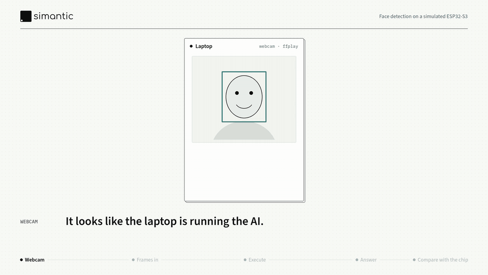
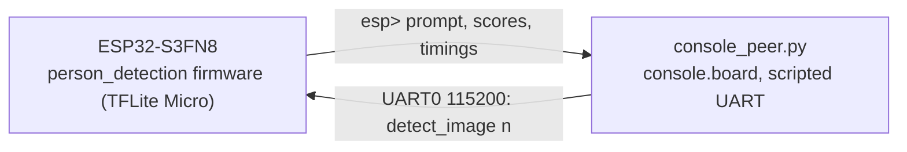
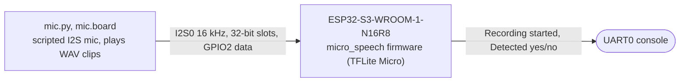
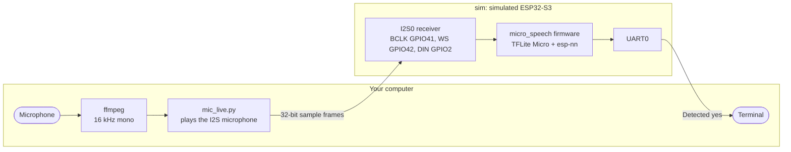
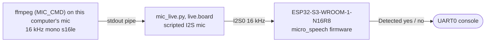

# Edge AI on a simulated ESP32-S3

Espressif's TensorFlow Lite Micro examples, running on the ESP32-S3's vector instructions inside
the [Simantic](https://simantic.com) simulator. No board, no toolchain: the firmware images are
in this repo.

[](media/emulator-explainer.mp4)

```sh
git clone https://github.com/simantic-dev/esp32-s3-edge-ai && cd esp32-s3-edge-ai
./demo camera    # face detection on your webcam (needs ffmpeg)
./demo person    # person detection on ten test images
```

You need `sim` 0.10.1 or newer and a free account (`speech` and `live` need the release after
0.10.1, which adds the I2S microphone):

```sh
curl -fsSL https://simantic.com/install | sh
```

## The demos

| Command | What runs |
|---|---|
| `./demo person` | Person detection on ten test images. Prints each score and the inference time the firmware measured. |
| `./demo speech` | Keyword spotting. A simulated I2S microphone plays a spoken "yes" and "no" from WAV files. |
| `./demo live` | The same, from your computer's microphone. Say "yes" or "no". |
| `./demo camera` | Face detection on your webcam. The simulated chip finds the faces; your computer draws the boxes. |

Add `real` after the name to run the same demo on an ESP32-S3 DevKit instead of the simulator:
`./demo person real`, `./demo camera real [seconds]`. It flashes the demo's image and runs the
same Python peer on the board's COM (USB-UART) port, which is wired to UART0:

```sh
PORT=/dev/cu.usbmodemXXXX FLASH_PORT=/dev/cu.usbmodemYYYY ./demo camera real
```

`PORT` is the COM port. `FLASH_PORT`, the board's native USB port, is optional: without it the
image goes through `PORT`, but on our board the COM port's WCH chip failed every flash with a
checksum error and the native port never did. Needs `pip install pyserial esptool`; `PYTHON`
picks the interpreter. The keyword spotters need an I2S microphone on the board and stay
simulator-only.

### `./demo person`




Espressif's `person_detection` example with no source edits. The model is TensorFlow's person
classifier (MobileNet v1, 96x96 grayscale, int8): person or no person, no boxes. A twelve-line
Python script on the other end of UART0 types `detect_image 0` to `detect_image 9` at the
firmware's console.

The image is built for an ESP32-S3 without PSRAM, and we ran this exact `flash.bin` on one:

| | Real chip | Simulator |
|---|---|---|
| Inference time | 49 ms | 50 ms |
| Depthwise conv / conv layers | 20 ms / 28 ms | 20 ms / 28 ms |
| Scores, ten images | identical | identical |

Image 3 is a monkey and image 7 is a portrait; the model gets both wrong, on the chip too. If
you have the board, flash it and compare: `esptool.py write_flash 0x0 person-detection/flash.bin`.

### `./demo speech`




Espressif's `micro_speech` example, also unedited. It has no test mode: it configures I2S0 at
16 kHz and listens to a microphone. `keyword-spotting/mic.py` is that microphone, a Python
script on the I2S data line that plays the example's own test clips. Four seconds of audio take
a couple of seconds to run, because firmware that is waiting for samples costs almost nothing to
simulate.

This one has not been run on a board. The detections are the simulator's.

### `./demo live`

Needs `ffmpeg` (`brew install ffmpeg`) and any microphone your computer can see: built-in,
headset, webcam. `./demo live` records one second first and tells you if it hears nothing, so
you find out about a missing microphone or a blocked permission before the chip boots. Then wait
for `Audio Recording started` and speak.



`./demo speech` is the same picture with `mic.py` reading WAV files in place of the microphone
and ffmpeg. The firmware is identical and cannot tell which one it is talking to.

A `mic level` bar prints once a second with the loudest sample the chip received, from -60 to 0 dB.
Speech should fill about two thirds of it.

- Wrong microphone? `./demo mics` lists them, `MIC=1 ./demo live` picks one.
- Quiet bar? Leave the gain alone: the model normalizes loudness itself, and in a test it caught 5 of 6 words at the default gain but missed every "no" with `MIC_GAIN=8`.


- The model knows two words, "yes" and "no".
- The stock example classifies back-to-back one-second windows, so a word that straddles two
  windows can be missed. Say it again.

`./demo live 300` runs for five minutes instead of one. `MIC_CMD` replaces the capture command
entirely (anything that writes 16 kHz mono s16le to stdout). Linux uses PulseAudio (`sudo apt install ffmpeg pulseaudio-utils`); WSL2 gets the Windows
microphone through WSLg. Neither has been tried.

### `./demo camera`

Needs `ffmpeg` (with `ffplay`) and a webcam. A window opens in two halves: on the left your
camera, live; on the right the last frame the chip was sent, as it got it (160x120, scaled up),
with the box the chip answered for that frame. The right half lags on purpose: it changes when
the chip answers.

The firmware is Espressif's [ESP-DL](https://github.com/espressif/esp-dl) `human_face_detect`
example (v3.3.14) with two changes: frames arrive on UART0 instead of from an embedded JPEG
(`face-detection/app_main.cpp`), and the model is ESP-DL's one-stage `ESPDET_PICO_224_224_FACE`
(ESPDet-Pico, Espressif's cut-down YOLOv11 from
[esp-detection](https://github.com/espressif/esp-detection), 0.36 M parameters, int8)
instead of the example's default two-stage MSR+MNP, which found no face in webcam frames of
someone looking down at a laptop. The kernels are ESP-DL's int8 convolutions on the S3's vector
instructions (`ee.vmulas` and friends; about 97,000 vector instructions in the image).

The image is built for the board we checked it on, an ESP32-S3 with 2 MB of quad PSRAM, and the
simulator runs it on the matching module (`ESP32-S3-WROOM-1-N8R2`): `./demo camera` and
`./demo camera real` run the same file. UART0 is a DevKit's COM (USB-UART) port, so the log goes
to the native USB port. `face-detection/camera.py` is the camera, a scripted peer on UART0:

```
chip -> "F\n"                       ask for a frame
host -> 160 x 120 x 3 bytes          RGB888, the newest webcam frame, at 2 Mbaud
chip -> "B x1 y1 x2 y2 score\n" ...  one line per face, then "E <ms>\n"
```

The chip asks for the next frame before it runs the detector on this one, so the next frame
arrives while it computes. `camera.py` pairs each answer with the frame it was for.

#### Optimized in the simulator, confirmed on the board

The first version asked for a frame, waited for all of it, then ran the detector. The simulated
chip's own timestamps showed where each frame's time went before anyone touched a board: 0.29 s
receiving 57,600 bytes at 2 Mbaud, with the CPU doing nothing useful, then 0.19 s of inference.
Waiting was 60% of every frame.

So the firmware double-buffers, as a camera driver would: it asks for frame N+1, then detects
frame N while N+1's bytes land in a 64 KB UART driver buffer. That change was written and run in
the simulator, which predicted one answer every 290 ms instead of 480. Flashed to the board
unchanged:

| One answer every | Before | After |
|---|---|---|
| Simulator (chip time) | 480 ms | 290 ms |
| Board | 570 ms (1.75 fps) | 290 ms (3.4 fps) |

The board doubled its frame rate from a change made and checked without it. Read the match with
one caveat: the two land on 290 ms for different reasons. In the simulator the transfer (290 ms)
is now the longer of the two and sets the pace; on the board the inference (287 ms) does, because
the simulator runs this model's inference 32% fast (the PSRAM store costs below). The prediction
"the chip stops waiting for the wire" held; the exact millisecond is partly luck.

The board's 290 ms is its steady pace, not its average. Over a 25 s run it averaged 423 ms (2.4
fps): at 2 Mbaud a few bytes of a frame are sometimes lost, and the chip waits out a 2 s read
timeout before asking again. The simulated link never loses a byte, so the simulator cannot show
this; a lossy link for the camera peer is the next test to add.

Wall-clock speed is another matter: the simulator runs this code about 3x slower than real time on
an M-series Mac, so the simulated demo shows about one answer a second (0.94), and the change cost
it a little (from 1.3), since the UART interrupts that now run during inference are simulated too.

`./demo camera 300` runs for five simulated minutes instead of one. `CAM_CMD` swaps the capture
command (anything writing 640x480 rgb24 to stdout; the default is macOS's camera 0).

#### Checked against a board

The same detector, timed on a real ESP32-S3 with 2 MB of quad PSRAM and on the simulator's
matching module. `face-detection/bench.bin` runs the example's own test photo ten times and
prints each time (`bench_main.cpp`; `./build.sh bench` rebuilds it):

| | Real chip | Simulator (`ESP32-S3-WROOM-1-N8R2`) |
|---|---|---|
| Score and box | 0.893, [98 57 198 194] | 0.893, [98 57 198 194] |
| First run | 464 ms | 334 ms |
| Runs 2 to 10 | 278 ms | 191 ms |

The answers are identical. The time is not: here the simulator is about 30% fast, where the
person detector, whose tensors sit in internal RAM, matched within a millisecond. This model's
tensors are in PSRAM, so, as with the PSRAM person build below, trust the simulator's ranking
more than its number. Espressif quotes 129 ms for this model with octal PSRAM and a 64 KB data
cache, a configuration we have not run on a board.

```sh
esptool.py write_flash 0x0 face-detection/bench.bin   # then watch the console
sim ESP32-S3-WROOM-1-N8R2 run --elf face-detection/bench.bin --ascii uart0 --only-messages --timeout 4
```

#### The same demo on a board

`./demo camera real` flashes `face-detection/flash.bin` and runs `camera.py` on the board's COM
port (`real.py` carries any demo's peer to a serial port). On the board each inference took 275
to 276 ms, the same as the benchmark; in the simulator the same file takes 187 ms, the same 32%
as the benchmark, so on quad PSRAM the simulator is consistently fast on this model.

The cause is stores. The simulator's data cache charges a PSRAM line fill on a load miss, close to
silicon, but its stores are free and allocate nothing. Measured on this board with interrupts off,
in cycles per line above an all-hits sweep:

| | Board, 32 / 64-byte lines | Simulator |
|---|---|---|
| Load miss, clean line evicted | 265 / 457 | 252 / 444 |
| Store miss, clean line evicted | 261 / 453 | 0 |
| Load or store miss, dirty line evicted | 517 / 901 | 0 |

A store miss fills the line as a load does (write-allocate), and evicting a dirty line costs
about one more fill (the write-back). The detector writes every layer's output to PSRAM, so it
pays both all the time; the person detector, all in internal RAM, never misses. The two simulated PSRAM types also disagree with each other in opposite
directions; this build for octal PSRAM, an earlier version of the demo, took about 490 ms:

| Module | Simulator | Reference |
|---|---|---|
| quad, `N8R2` | 187 ms | 275 ms on our board |
| octal, `N16R8` | about 490 ms | 129 ms + 7 ms preprocessing, Espressif's figure; not run by us |

We have no octal-PSRAM board, so the second row compares the simulator with a published number,
not with a measurement of ours.

## How it is wired

Each demo is one `sim` command (read `demo`, it is 30 lines): a chip, a firmware image and a
board file. The board file names the parts on the chip's pins. Here the parts are Python:

```
mic: Sound.ScriptedI2sPeer @ none
    i2s: i2s0
    file: "mic.py"
```

Change the script and you have changed the hardware. `mic.py` is where you would put your own
recordings; `console_peer.py` is where you would type different commands.

## Rebuilding the firmware

`person-detection/build.sh`, `keyword-spotting/build.sh` and `face-detection/build.sh` are the
exact recipes, on ESP-IDF v5.4.4. Useful things to try on the person detector, all of which we checked against the board:

| Change in `sdkconfig` | Real chip | Simulator |
|---|---|---|
| none | 49 ms | 50 ms |
| `CONFIG_NN_ANSI_C=y` (plain C kernels, no vector instructions) | 439 ms | 447 ms |
| `CONFIG_ESP_DEFAULT_CPU_FREQ_MHZ_160=y` | 71 ms | 71 ms |
| `CONFIG_ESP32S3_DATA_CACHE_32KB=y` | 49 ms | 50 ms |
| `CONFIG_COMPILER_OPTIMIZATION_SIZE=y` | 49 ms | 50 ms |

With the tensor arena in quad PSRAM (an ESP32-S3R2) the chip takes 61 to 62 ms and the simulator
says 57, so on PSRAM builds trust the ranking more than the number.

## Licenses

Scripts, board files and `face-detection/*.cpp`: MIT. Firmware images and audio clips: builds
and copies of Apache-2.0 and MIT work by Espressif and the TensorFlow authors; see `NOTICE`. The simulator itself is a commercial
product and is not part of this repository.
